# PGPKeyDesk for Android

Android port of the Windows app [PGPKeyDesk](https://github.com/domezos2024/OpenGPG): manage **OpenPGP key profiles** and **encrypt, decrypt, sign and verify** text and files. Built with Kotlin, Jetpack Compose and [BouncyCastle](https://www.bouncycastle.org/) - no GnuPG needed. The UI is available in **English and German**, with a **light and a dark theme**.

## Features

- **Profiles:** generate RSA 2048/4096 key pairs (optional expiry), import/export `.asc`, keys are validated on import
- **Decrypt** PGP messages (paste, open a file, or share text into the app) with an optional signature check against a sender key
- **Encrypt** text; with a profile selected the message is additionally **signed**
- **Recipient keyring** with fingerprints; expired or revoked keys are blocked, keys expiring within 30 days are flagged, a warning is shown at startup
- **Files:** encrypt, decrypt, sign and verify files (up to 200 MB, optional ASCII armor); results are written to a temp file first and saved only on success
- **Settings:** theme (follow system / light / dark) and language (system / English / Deutsch)

## Screenshots

All screenshots were taken in the Android emulator with throw-away demo keys (*Alice (Demo)* and *Bob (Demo)*); no real data is shown.

### First start

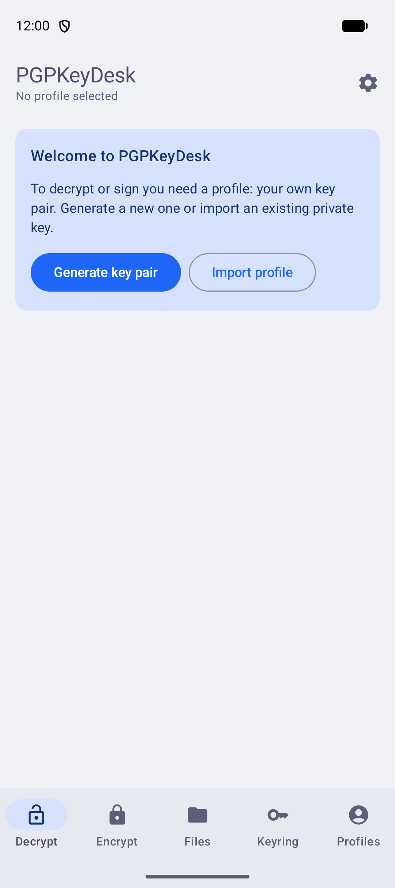

Without a profile the app explains what is needed: a profile is your own key pair. Tap **Generate key pair** to create one, or **Import profile** to use an existing private key.

### Generate a key pair

| Form | New-profile menu |
|---|---|
| 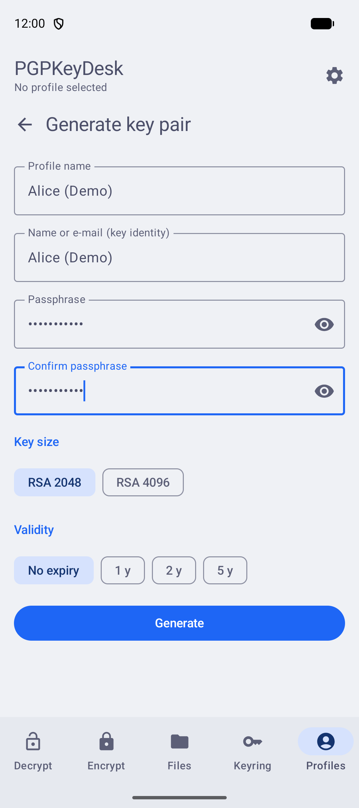 | 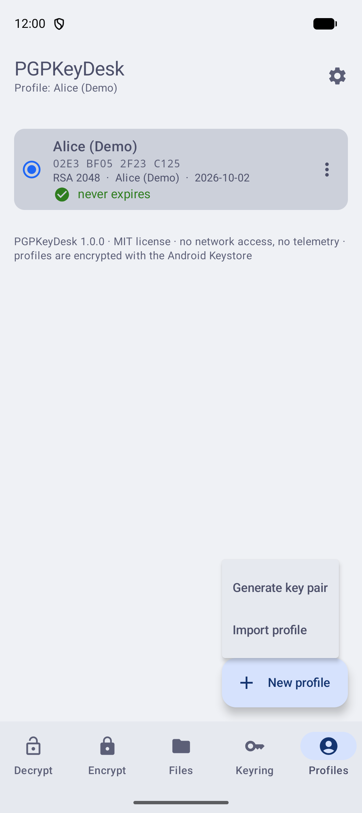 |

Choose a profile name, a key identity (name or e-mail), a passphrase, the key size (RSA 2048 or 4096) and the validity. The key pair is created on the device; RSA 4096 takes noticeably longer on a phone. Afterwards save it as a profile and export a backup. The **New profile** button on the Profiles tab offers *Generate key pair* and *Import profile*.

### Decrypt - with signature check

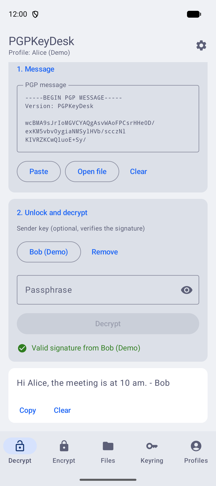

Paste the PGP message (or use **Open file**, or share text into the app from another app), optionally pick the sender's public key from the keyring, enter the passphrase of the selected profile and tap **Decrypt**. The result shows whether the signature is *valid*, *invalid* or *missing*. Copying the plaintext clears the clipboard automatically after 60 seconds.

### Encrypt

| Recipient and message | Encrypted result |
|---|---|
| 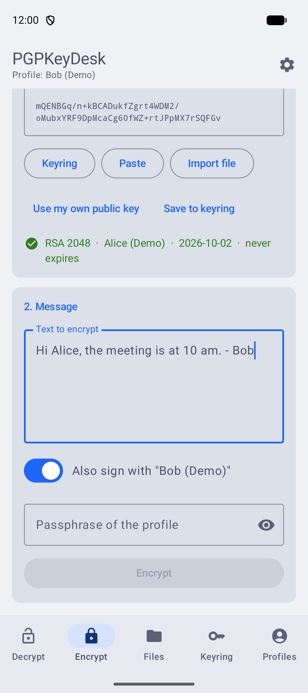 | 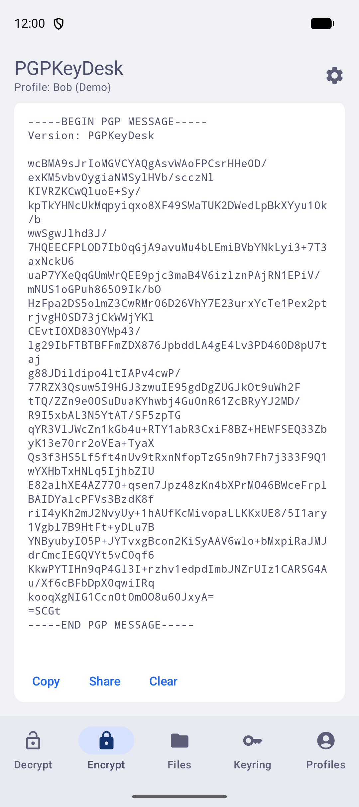 |

Pick the recipient from the keyring or paste a public key. The app shows algorithm, user ID and expiry; expired or revoked keys are blocked and keys that expire soon are flagged. With a profile selected the message is also signed. Copy or share the armored result.

### Files

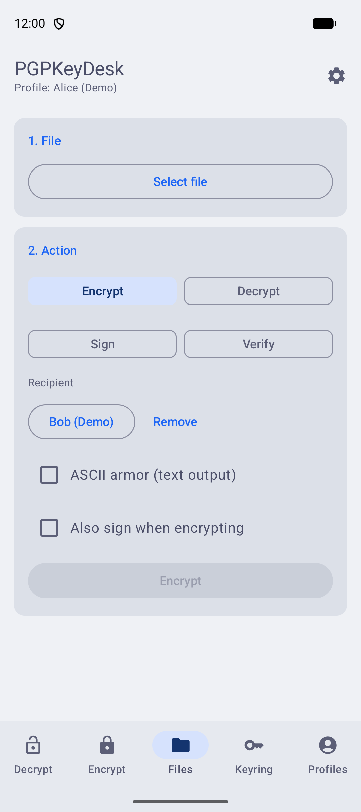

Select a file, choose an action (*Encrypt*, *Decrypt*, *Sign*, *Verify*) and only the fields that action needs are shown. The result is processed into a temporary file first, so a failed operation never leaves a damaged file behind; you then choose where to save it.

### Recipient keyring

| Keyring | Add a key |
|---|---|
| 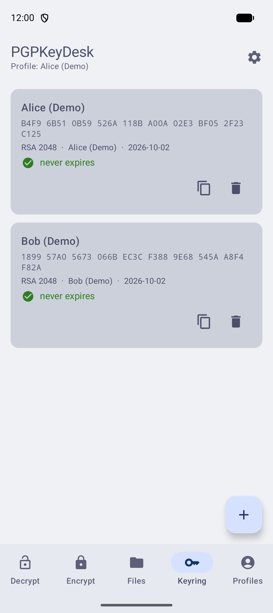 | 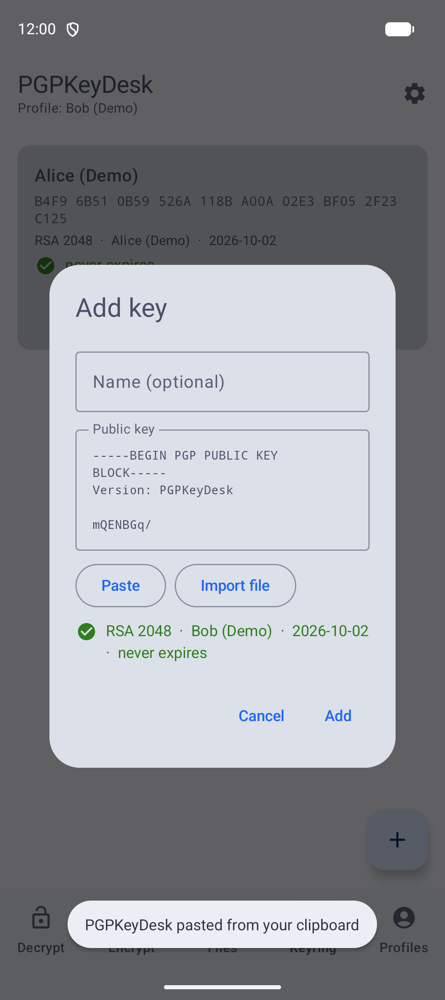 |

Store recipients' public keys once. Each entry shows the fingerprint and the key status; the add dialog validates the key while you type. Keys can be pasted, imported from a file or received through the share sheet.

### Profiles

| Profiles | Profile menu |
|---|---|
| 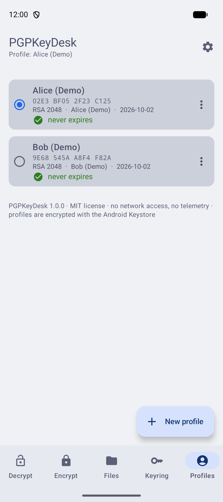 | 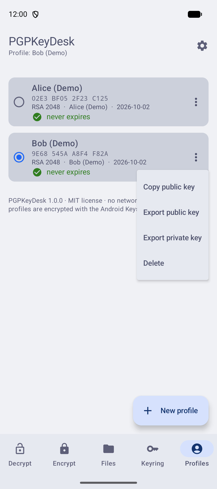 |

The selected profile (radio button) is used to decrypt and sign. The menu copies or exports the public key, exports the private key (still protected by its passphrase) or deletes the profile.

### Dark theme and language

| Settings (dark) | Decrypt (dark) | Files (dark) |
|---|---|---|
| 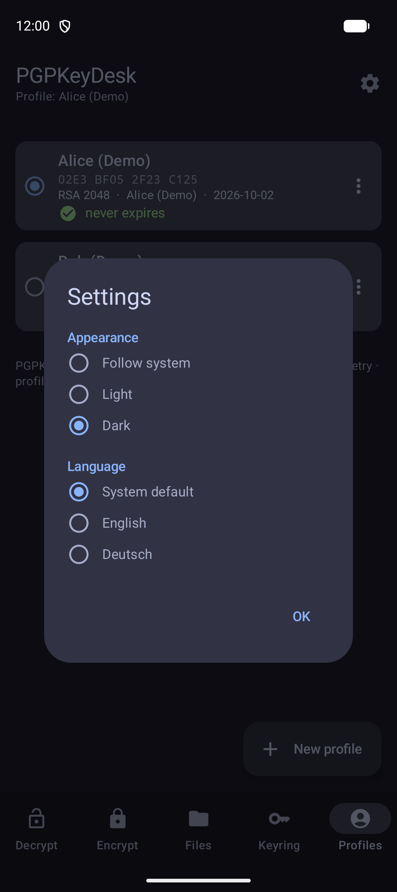 | 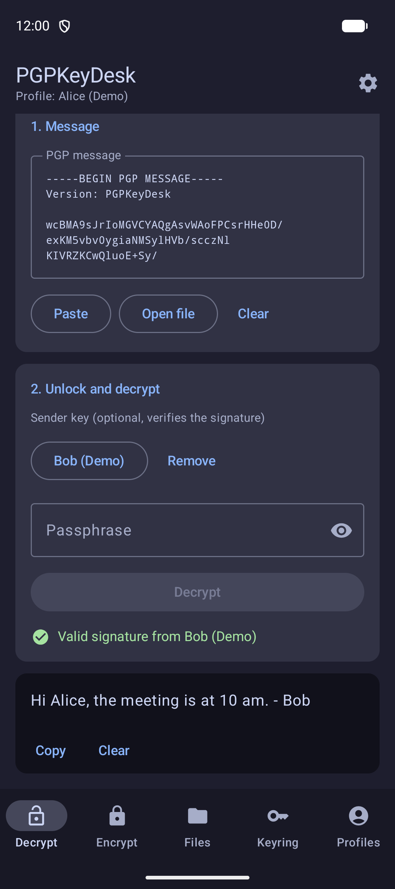 | 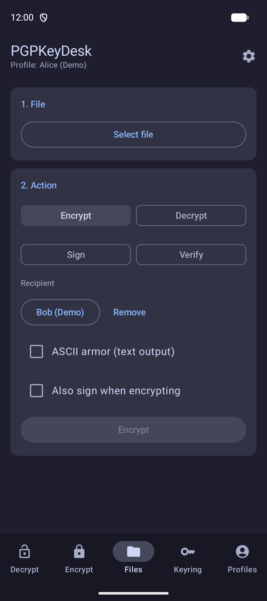 |

| Encrypt (dark) | Keyring (dark) | Profiles (dark) |
|---|---|---|
| 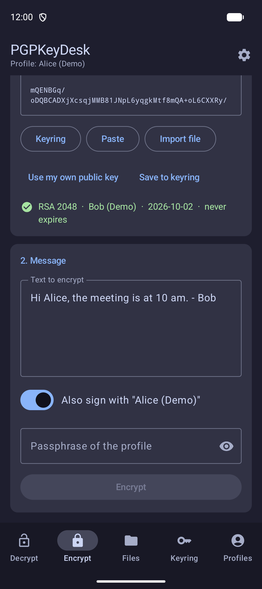 | 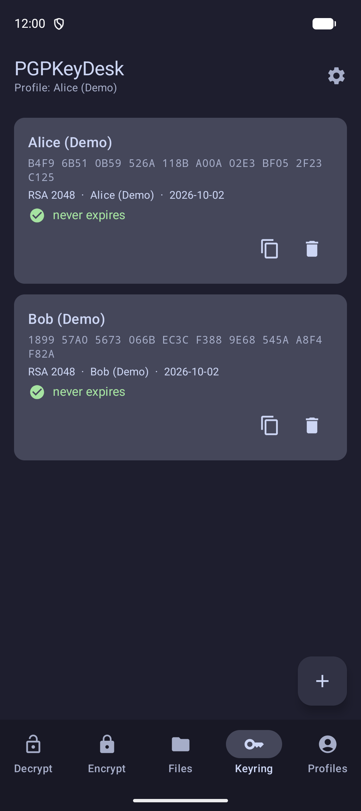 | 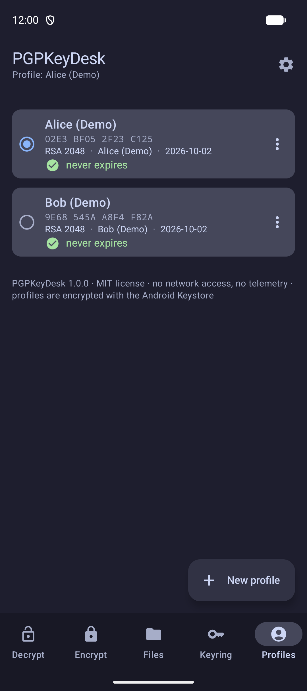 |

The gear icon opens the settings: **Follow system / Light / Dark** and **System default / English / Deutsch**. The language switches immediately; the app also appears in Android's per-app language settings.

| Settings (light) | Decrypt (German) | Files (German) | Profiles (German) |
|---|---|---|---|
| 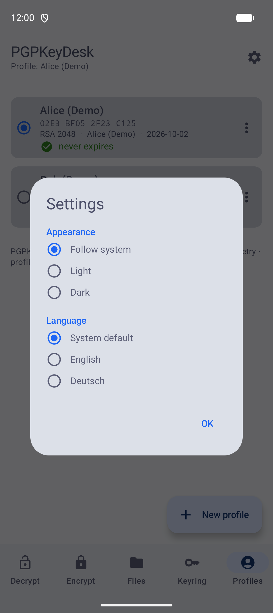 | 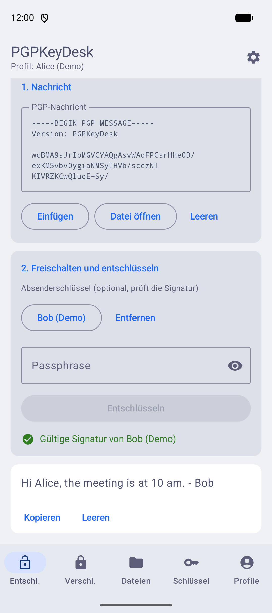 | 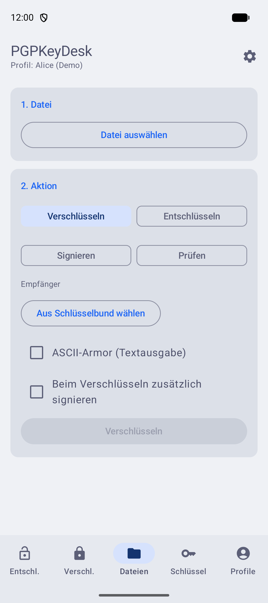 | 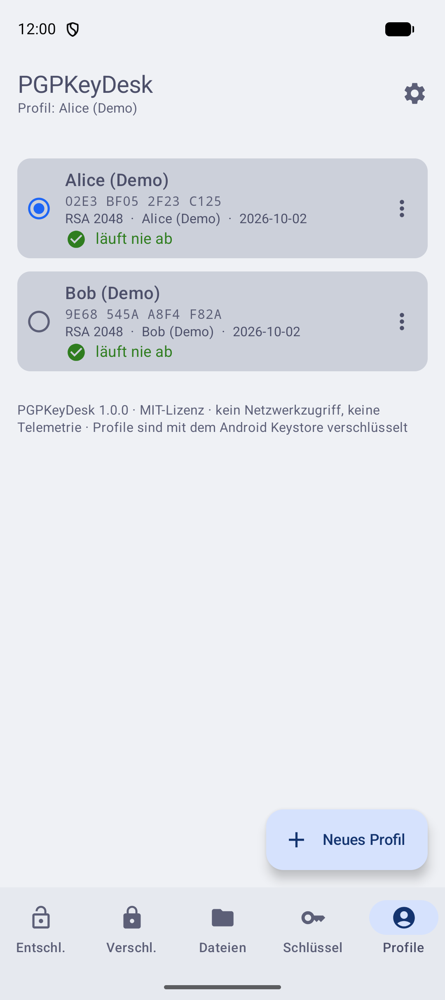 |

## Security

- Profiles are stored AES-256-GCM encrypted with a non-exportable Android Keystore key (counterpart of Windows DPAPI)
- Passphrases are never stored; no INTERNET permission, no telemetry, backups disabled
- Release builds set `FLAG_SECURE` (no screenshots or recents preview)
- Decrypted text is copied as sensitive content and the clipboard is cleared after 60 seconds
- Not an audited product; use established tools for highly critical cases

## Build

Requirements: JDK 17+, Android SDK 35.

```
./gradlew testDebugUnitTest assembleDebug
./gradlew assembleRelease   # unsigned unless PGPKEYDESK_KEYSTORE* env vars are set
```

Signing env vars: `PGPKEYDESK_KEYSTORE`, `PGPKEYDESK_KEYSTORE_PASSWORD`, `PGPKEYDESK_KEY_ALIAS`, `PGPKEYDESK_KEY_PASSWORD`.

## Project layout

| Path | Contents |
|------|----------|
| `core/` | `PgpService` (BouncyCastle operations), `KeyValidator`, `KeyExpiry`; UI-independent and unit-tested |
| `data/` | encrypted profile store, keyring, Keystore protector, settings, clipboard, file helpers |
| `ui/` | Compose screens: Decrypt, Encrypt, Files, Keyring, Profiles, Settings |

License: MIT
